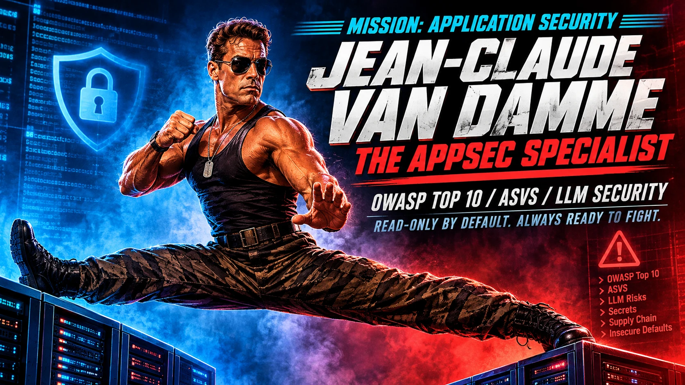

!['Your attack surface just met its match.' - Jean-Claude Van Damme, Bloodsport. 'No bugs left standing.' - Jean-Claude Van Damme, Kickboxer. 'Every vulnerability has a weak spot.' - Jean-Claude Van Damme, Universal Soldier. 'Code hard. Review harder.' - Jean-Claude Van Damme, Double Impact. 'Security is not a suggestion. It’s a roundhouse kick.' - Jean-Claude Van Damme, Timecop. 'Breaking threats. Not your code.' - Jean-Claude Van Damme, Hard Target. 'The code fights back. We fight harder.' - Jean-Claude Van Damme, The Quest.](assets/quotes.svg)

# jean-claude-van-damme

A Claude skill for security review and secure coding. It covers the OWASP Top 10, ASVS, LLM/agent risks, secrets, supply chain and insecure defaults, with diff-based review and false-positive triage. It is read-only by default: it reports findings and proposes fixes without editing code unless asked.

## Install

### Claude Code (plugin marketplace)

```
/plugin marketplace add as-one/jean-claude-van-damme
/plugin install jean-claude-van-damme@as-one
```

### Claude Code (one command, without the plugin)

Uses [degit](https://github.com/Rich-Harris/degit) (needs Node.js) to copy only the skill folder.

Personal install:

```bash
npx degit as-one/jean-claude-van-damme/skills/jean-claude-van-damme ~/.claude/skills/jean-claude-van-damme
```

Per project, from the root of your repository:

```bash
npx degit as-one/jean-claude-van-damme/skills/jean-claude-van-damme .claude/skills/jean-claude-van-damme
```

To update, run the same command with `--force`. It writes over the files in that folder, so keep local changes elsewhere.

### Claude Code (manual)

```
git clone https://github.com/as-one/jean-claude-van-damme.git
cp -r jean-claude-van-damme/skills/jean-claude-van-damme ~/.claude/skills/
```

Per project: copy the same folder to `.claude/skills/` inside your repository.

### Claude.ai / Claude Desktop

Zip the `skills/jean-claude-van-damme` folder and upload it under Settings > Capabilities > Skills.

## Updating the plugin

### Automatic

Auto-update is off by default for third-party marketplaces. To turn it on in Claude Code:

1. Run `/plugin`.
2. Open the **Marketplaces** tab.
3. Select `as-one` and enable auto-update.

Claude Code then checks in the background after your first message, with a delay of up to ten minutes. When it reports that the plugin was updated, run `/reload-plugins`, or start a new session. If auto-update is disabled by environment variables such as `DISABLE_AUTOUPDATER`, see the [plugin documentation](https://code.claude.com/docs/en/discover-plugins).

### By hand

```bash
claude plugin marketplace update as-one
```

```bash
claude plugin update jean-claude-van-damme@as-one
```

Restart Claude Code to apply the update.

## Usage

Just ask. The skill loads on security requests such as these:

| You want to | Ask something like |
|---|---|
| Review your changes | "review my changes for security issues" |
| Check one thing before merging | "is this safe to ship?" |
| Audit a project | "audit this repo" |
| Take a fast look | "quick security look at the auth code" |
| Check infrastructure | "is this GitHub Actions workflow safe?" |
| Review an agent | "check this MCP server for prompt injection risks" |
| Write code securely | "add a file upload endpoint, securely" |
| Look for leaked secrets | "check for secrets in the code" |
| Plan before building | "threat model this feature" |

To call it explicitly in Claude Code (plugin install):

```
/jean-claude-van-damme:jean-claude-van-damme review the changes in this branch
```

With a degit or manual install, use `/jean-claude-van-damme`.

### Scopes

| Scope | Covers |
|---|---|
| diff | Changed files and their callers and callees |
| quick | Entry points, auth, secrets and injection sinks |
| full | The whole repository |

If you do not name one, it uses diff when there is a Git diff and quick otherwise.

### Progress checklist

During a review, the skill posts a checklist in the conversation and ticks phases as it finishes them:

```
Security review progress
- [x] 1. Recon
- [x] 2. Entry points and trust boundaries
- [x] 3. Risk-rank files
- [ ] 4. Hunt by category
- [ ] 5. Triage candidates
- [ ] 6. Regression check (diff scope)
- [ ] 7. Report
```

### What you get

Findings ordered by severity, each with the path from input to sink, followed by what was not reviewed. Illustrative example:

```
### [High] Any user can read any invoice  (CWE-639, A01:2025 Broken Access Control, confidence: High)
- Location: api/invoices.py:42
- Path: invoice_id (URL) -> get_invoice() -> SELECT without owner filter
- Impact: a logged-in user reads other customers' invoices
- Fix: filter by owner_id of the current user
```

It does not edit code unless you ask, and it does not run code from the project under review without your explicit request. It is a model-driven review, not a scanner: pair it with tools such as Semgrep, gitleaks and your package manager's audit.

## Layout

```
.claude-plugin/
  plugin.json
  marketplace.json
skills/
  jean-claude-van-damme/
    SKILL.md               # workflow, triage rubric, report format
    reference/             # read only when the review needs it
      review-checklist.md  # coverage checklist by topic
      owasp-codes.md       # short index of OWASP and ASVS IDs
      owasp-top10.md       # Top 10:2025 in detail, with examples
      asvs.md              # ASVS 5.0 requirements by chapter and level
      owasp-ai.md          # LLM and Agentic Top 10 (2026) in detail, with examples
      languages.md         # pitfalls and examples for 19 language groups, SSRF, uploads, secrets
      iac-and-ci.md        # CI/CD, lockfiles, SBOM and signing, containers, cloud, headers, with examples
evals/                     # test cases for `claude plugin eval`
scripts/
  test-graders.mjs         # offline checks for the eval graders
```

## Evals

### Check the graders (free, offline)

```bash
node scripts/test-graders.mjs
```

It checks the structure of every case and tests each pattern-based grader against text that should and should not match. When you add a `regex` grader, add its samples to the script. The judgment of `llm` graders is not tested offline.

### Run the evals

The command compares results with the skill against a baseline without it. It calls real models and is charged to your account, so set a ceiling with `--max-cost-usd`.

```bash
claude plugin eval . --no-publish --judge-model sonnet --max-cost-usd 5
```

Run them before and after changing the skill. Results are written to `evals/results/`, which is ignored by Git.

## Updating the codes

OWASP editions change over time. Once a year, check the sources listed in `reference/owasp-codes.md`, update `owasp-codes.md`, `owasp-top10.md`, `asvs.md`, `owasp-ai.md` and their check dates, review the IDs cited in `review-checklist.md`, and bump the plugin version.

## License

MIT (see [LICENSE](LICENSE)), except for the reference files that summarize OWASP material (OWASP and ASVS names and IDs belong to the OWASP Foundation):

| File in `reference/` | Terms |
|---|---|
| `asvs.md`, `owasp-ai.md` | CC BY-SA 4.0 |
| `owasp-top10.md` | Summaries of OWASP Top 10 material, which is CC BY 3.0; attribution required |
| `owasp-codes.md` | Names and IDs from the sources listed in the file, under their licenses |
